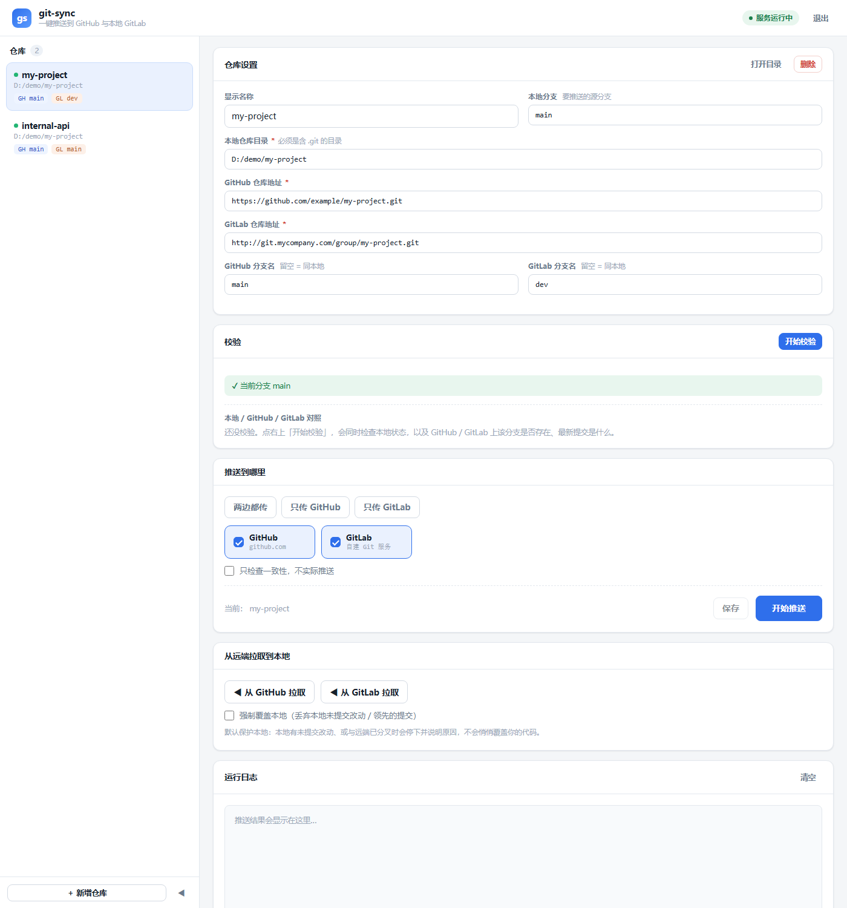

# git-sync

**一键把本地代码同时推送到两个远端（GitHub + 自建 GitLab / Gitea / 任意 git 服务），并在推送前告诉你远端到底长什么样。**

自带浏览器界面，零第三方依赖（只用 Python 标准库）。适合这种场景：

- 代码要**同时**放到公网 GitHub 和公司内网 GitLab
- 内网是自建 git 服务（HTTP、非标准端口），配置繁琐
- 两个远端的分支名**不一样**（比如本地 `main` 推到内网叫 `dev`）
- 想知道"远端那个分支到底有没有、最新提交是哪一个"

---

## 它解决什么问题

多远端同步的坑，基本都在这几处：

| 坑 | git-sync 的处理 |
|---|---|
| 本机代理拦截内网地址，内网 git 连不上 | 自动把内网地址加入 `no_proxy` |
| 两个远端分支名不同 | 用 `本地:远端` 改名推送，同名时才设 upstream |
| 远端有本地没有的提交 | git 会拒绝（非快进）—— 界面直接告诉你原因和出路，**不会静默覆盖** |
| 只推了其中一个，另一个忘了 | 支持"两边都传 / 只传 GitHub / 只传 GitLab" |
| **两个远端填成了同一个地址** | **直接拦下并报警** —— 否则会把代码推两遍到同一个仓库，另一个远端其实什么都没收到，却还报成功 |
| 远端分支还不存在，怕报错 | 推送时会自动创建，界面会提前注明"推送时将新建" |

---

## 界面



五个区域，从上到下就是一次完整操作：

1. **仓库设置** —— 填本地目录、两个远端地址、分支
2. **校验** —— 一次点击，同时检查本地状态和两个远端的分支情况
3. **推送到哪里** —— 选择目标后推送
4. **从远端拉取到本地** —— 反向操作
5. **运行日志** —— 实时滚动，颜色区分成功/警告/失败

左侧仓库列表可以收起（点左下角的 ◀）。

---

## 环境要求

- **Python 3.8+**（标准库即可，无需 `pip install`）
- **Git**（在 PATH 里，或装在常见位置 —— 脚本会自动探测）
- Windows / macOS / Linux

> 启动脚本会自己找 Python：PATH → `py` 启动器 → 便携版目录。它会**主动跳过 Windows 应用商店那个 0 字节的 `python.exe` 占位符**（那东西运行时什么都不做、也不报错，会让进程管理器一直卡在"启动中"）。
> 如果你的 Python 装在很偏的地方，运行前设一下 `PYTHON` 环境变量指向它即可：
> ```
> set PYTHON=C:\somewhere\python.exe
> ```

> 界面基于 Python 标准库 `http.server`，只监听 `127.0.0.1`，不对外开放。

---

## 快速开始

```bash
git clone https://github.com/<you>/git-sync.git
cd git-sync
```

**1. 准备配置**

```bash
cp repos.example.json repos.json
```

编辑 `repos.json`（这个文件已被 gitignore，不会提交）。最简一条：

```json
{
  "repos": [
    {
      "name": "我的项目",
      "path": "D:/code/my-project",
      "github": "https://github.com/your-name/my-project.git",
      "gitlab": "http://git.mycompany.com/group/my-project.git",
      "branch": "main"
    }
  ]
}
```

**2. 启动界面**

- Windows：双击 `git-sync-gui.bat` —— 会自动打开浏览器
- 其它平台 / 手动：

```bash
python gui_server.py
```

**3. 在界面里点「开始校验」，确认三方状态没问题，再点「开始推送」。**

---

## 命令行用法

不想开界面时，同一个引擎也能直接用：

```bash
python git_sync.py            # 交互式：列出仓库，选编号推送
python git_sync.py 1          # 直接推第 1 个仓库
python git_sync.py 1 dev      # 临时改用 dev 分支
python git_sync.py --list     # 只看已登记仓库
python git_sync.py --check    # 不推送，只检查远端一致性
python git_sync.py --add      # 交互式登记新仓库
```

作为模块调用：

```python
import git_sync as gs

repo = {
    "name": "我的项目",
    "path": "/path/to/repo",
    "github": "https://github.com/you/proj.git",
    "gitlab": "http://git.internal/proj.git",
    "branch": "main",
}

# 推送到指定远端：("github",) / ("gitlab",) / 两个都要
ok, info = gs.sync_repo(repo, ("github", "gitlab"),
                        on_log=lambda level, text: print(level, text))

# 查远端状态（不修改任何配置）
print(gs.remote_status(repo))

# 从远端拉到本地（默认保护本地，不会丢改动）
gs.pull_repo(repo, source="github", force=False)
```

---

## 配置说明

| 字段 | 说明 |
|---|---|
| `name` | 显示名，随便起 |
| `path` | 本地仓库目录，必须含 `.git` |
| `github` / `gitlab` | 两个远端地址。**只填一个也能用**，推送时只选对应目标即可 |
| `branch` | 本地要推送的分支，默认 `main` |
| `github_branch` / `gitlab_branch` | 推到那边叫什么分支名，不填 = 同 `branch` |
| `no_proxy`（顶层） | 追加不走代理的内网地址，如 `["git.mycompany.com"]` |

---

## 关于凭据

git-sync 不自己管理密码，完全交给系统的 Git 凭据助手：

- **Windows**：Git Credential Manager，凭据存在「凭据管理器 → Windows 凭据」，条目形如 `git:http://git.mycompany.com`
- **macOS**：钥匙串
- **Linux**：`credential.helper store` / `libsecret`

第一次推送某个远端时会弹一次登录，之后免密。

给自建 GitLab 这类非 GitHub 的服务，建议加一条配置，避免它去走 GitHub 的 OAuth 流程：

```bash
git config --global credential.http://git.mycompany.com.provider generic
```

也可以直接指定哪些地址不走代理（等价于配置里的 `no_proxy`）：

```bash
export GIT_SYNC_NO_PROXY="git.mycompany.com,10.1.2.3"
```

---

## 拉取的安全约定

从远端拉到本地时，**默认不丢你的东西**：

| 情况 | 行为 |
|---|---|
| 本地有未提交的改动 | 拒绝，改动原样保留 |
| 本地与远端已分叉 | 拒绝快进，说明原因并给出两条出路 |
| 本地落后、可以快进 | 自动快进合并 |
| 本地已是最新 | 提示无需更新 |

只有显式勾选「强制覆盖本地」才会丢弃本地改动、硬对齐远端（界面会二次确认）。

---

## 文件结构

```
git-sync/
├── git_sync.py            核心：推送 / 拉取 / 远端查询（无依赖）
├── gui_server.py          本地 HTTP 服务 + JSON API
├── ui.html                界面
├── git-sync-gui.bat       Windows 双击入口（pythonw 无窗口启动）
├── service.bat            Windows 前台启动（供进程管理器托管）
├── repos.example.json     配置模板
├── docs/preview.png       界面截图
└── 使用说明.md             详细中文说明
```

---

## License

MIT
